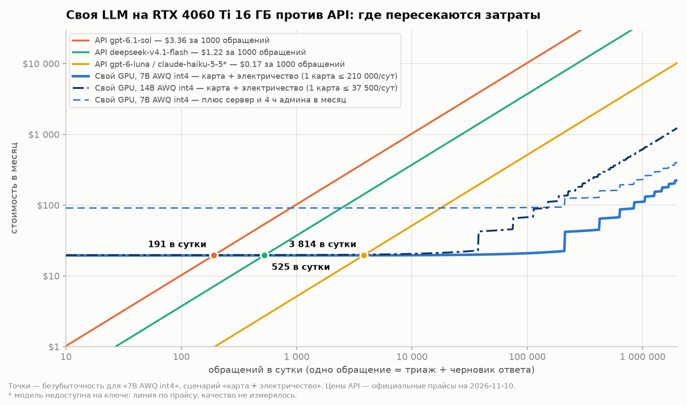

# Своя LLM или API: при какой нагрузке окупается



**Вопрос.** С какого потока обращений открытая модель на своей RTX 4060 Ti 16 ГБ дешевле внешнего API при том же SLA (p95 ≤ 10 с) — и сколько при этом теряется качества.

**Ответ в трёх строках.**

1. **По деньгам:** своя карта стоит ≈ $20 в месяц (≈ 8 800 ₸: амортизация + электричество) почти независимо от нагрузки. Она дешевле дорогого API уже с **≈ 190 обращений в сутки** (gpt-6.1-sol), среднего — с **≈ 530** (deepseek-v4.1-flash), самого дешёвого — с **≈ 3 800** (gpt-6-luna). Если считать ещё сервер и 4 часа администратора в месяц, пороги вырастают в 4,7 раза: ≈ 890 / 2 500 / 17 900.
2. **По качеству паритета нет:** 7B int4 даёт 57% обращений «всё верно» против 77% у самого дешёвого API (−20 п. п.); 14B AWQ — 69% (−8 п. п., в пределах погрешности на 150 примерах), но выдерживает в 5,6 раза меньший поток. На проверке документов (DocCheck) свои модели находят 75–86% заложенных ошибок против 96% у API.
3. **По скорости своя модель быстрее API:** 7B AWQ в vLLM держит 14 запросов/с при p95 4,4 с (≈ 210 000 обращений в сутки на одну карту с трёхкратным запасом на пик); API через роутер дал p95 5–13 с. Ollama на той же карте — 2 запроса/с: vLLM в 7 раз производительнее.

**Вывод:** своя модель окупается не «с N запросов», а там, где устраивает её качество. Для массового триажа с проверкой человеком — да, с первых тысяч обращений в сутки. Там, где ошибка маршрутизации дорога, дешёвый API остаётся выгоднее до десятков тысяч обращений в сутки и точнее на любом объёме.

## Таблица квантований

Одна RTX 4060 Ti 16 ГБ, vLLM 0.33 (`--gpu-memory-utilization 0.90 --enable-prefix-caching`), профиль нагрузки — поддержка: триаж обращения (≈ 890 токенов на входе, 21 на выходе) + черновик ответа (≈ 220 / 130).

| вариант | веса, ГБ | ток/с, 1 клиент | ток/с, 32 клиента | p95 при 32, с | макс. запросов/с при p95 ≤ 10 с | обращений в сутки на карту¹ | поддержка: всё верно² | DocCheck: найдено / ложных³ |
|---|---|---|---|---|---|---|---|---|
| **A** 7B FP8 (W8A8) | 8,7 | 31 | 762 | 7,8 | 10 | 150 000 | 60,0% | 78,6% / 15,5% |
| **B** 7B AWQ int4 | 5,6 | 54 | 1 137 | 4,3 | **14** | **210 000** | 56,7% | 75,0% / 6,9% |
| **C** 7B GPTQ int4 | 5,6 | 55 | 1 155 | 4,4 | **14** | **210 000** | 57,3% | 78,6% / 15,5% |
| **D** 14B AWQ int4 | 10,0 | 29 | 398 | 14,5 | 2,5 | 37 500 | **69,3%** | **85,7% / 1,7%** |
| **E** 7B GGUF Q4_K_M, Ollama | 4,7 | 48 | 144 | 22,2 | 2 | 30 000 | 58,0% | 83,9% / 13,8% |
| API gpt-6-luna | — | — | — | 11,6⁴ | — | — | 77,3% | — |
| API gpt-6.1-sol | — | — | — | 8,6⁴ | — | — | 76,7% | — |
| API deepseek-v4.1-flash | — | — | — | 12,7⁴ | — | — | 85,3% | 96,4% / 5,2% |

¹ С запасом на пиковый час: средний поток = максимум / 3; одно обращение = 1,92 запроса к модели.
² Тема, приоритет и исполнитель верны одновременно; 150 размеченных обращений, 95%-й интервал ± 6–8 п. п.
³ Доля найденных из 56 заложенных ошибок / доля ложных срабатываний на 58 чистых утверждениях.
⁴ При 8 одновременных клиентах, через роутер из Казахстана; у прямого подключения к провайдеру цифры могут быть лучше.

Что видно из таблицы:

- **AWQ и GPTQ неразличимы** ни по скорости, ни по качеству — выбирать можно по наличию готовых весов.
- **FP8 на этой карте проигрывает int4**: веса в 1,5 раза больше, под KV-кэш остаётся меньше памяти, скорость ниже на 30–45%, а качество в пределах погрешности то же.
- **14B заметно точнее на правилах** (маршрут 92% против 74–83%, один черновик с иероглифами против 9–12), но занимает 10 ГБ из 16 и выдерживает в 5,6 раза меньший поток.
- **Ollama один на один не медленнее vLLM** (48 против 54 ток/с), но не масштабируется: при 32 клиентах — 144 ток/с против 1 137.

Полные таблицы, включая точки безубыточности по всем вариантам: [report/tables.md](report/tables.md). Отчёт на две страницы: [report/REPORT.md](report/REPORT.md).

## Цена одного обращения

| | $ за 1000 обращений | ₸ за 1000 обращений |
|---|---|---|
| API gpt-6.1-sol | 3,36 | 1 511 |
| API deepseek-v4.1-flash | 1,22 | 549 |
| API gpt-6-luna | 0,17 | 76 |
| API claude-haiku-5-5 (не измерен, оценка по прайсу) | ≈ 0,17 | ≈ 76 |
| свой GPU, 7B AWQ, при 10 000 обращений в сутки | 0,064 | 29 |
| свой GPU, 7B AWQ, при полной загрузке карты | 0,004 | 1,6 |

Цены API — **официальные прайсы провайдеров** на 10.11.2026, умноженные на фактический расход токенов каждой модели на этом же наборе (модели с рассуждением тратят в разы больше выходных токенов — это учтено). Цена роутера, через который шли прогоны, в расчёте не участвует. Все входные данные модели — в [configs/prices.yaml](configs/prices.yaml): курс 448,98 ₸/$, новая карта 270 000 ₸, амортизация 3 года с остаточной стоимостью 25%, тариф 45,59 ₸/кВт·ч, измеренные 13 Вт в простое и 136 Вт под нагрузкой плюс 80 Вт на остальной системный блок.

## Как устроено

```
configs/variants.yaml   пять вариантов A–E
configs/prices.yaml     все входные данные модели стоимости
bench/                  задача (промпты поддержки), клиент со стримингом, опрос nvidia-smi
scripts/serve.py        поднимает вариант в Docker (vLLM или Ollama) и ждёт готовности
scripts/loadtest.py     1/8/32 одновременных клиента + ступенчатый тест с пуассоновским потоком до нарушения SLA
scripts/eval_triage.py  качество на 150 обращениях: тот же промпт для своей модели и для API
scripts/quantize_fp8.py квантование 7B в FP8 через llm-compressor (готовых весов нет)
scripts/cost_model.py   модель стоимости, точка безубыточности, график
scripts/make_tables.py  таблицы отчёта из results/
scripts/run_all.sh      полный прогон вариантов по очереди
results/                сводные результаты всех прогонов (JSON)
```

## Как повторить

Нужны: видеокарта NVIDIA с 16 ГБ, Docker с доступом к GPU (на Windows — Docker Desktop с WSL2), [uv](https://docs.astral.sh/uv/), ≈ 60 ГБ на диске.

```bash
uv sync
```

```bash
cp .env.example .env
```

В `.env` вписывается ключ OpenAI-совместимого API — он нужен только для замера качества и токенов API-моделей.

```bash
bash scripts/run_all.sh B C D
```

Вариант A сначала квантуется (≈ 2 минуты на CPU, скачивает 15 ГБ исходных весов):

```bash
docker run --rm --entrypoint bash -v own-llm-vs-api_hf-cache:/root/.cache/huggingface -v own-llm-vs-api_models:/models -v "$PWD/scripts:/scripts" vllm/vllm-openai:v0.33.0 -c "pip install -q llmcompressor && python3 /scripts/quantize_fp8.py"
```

```bash
bash scripts/run_all.sh A E
```

```bash
uv run python scripts/eval_triage.py --target api --model gpt-6-luna --name api_gpt-6-luna
```

```bash
uv run python scripts/cost_model.py && uv run python scripts/make_tables.py
```

Проверка на DocCheck запускается, только если рядом лежит репозиторий [DocCheck](https://github.com/Sinerror/doccheck); без него шаг пропускается.

## Ограничения

- **Данные синтетические:** 150 обращений и справочник сотрудников взяты из кейса [RuBert-Bitrix-Optimisation](https://github.com/Sinerror/RuBert-Bitrix-Optimisation). На реальной почте цифры качества будут другими; соотношение стоимости — нет.
- **Малая выборка:** 150 обращений дают интервал ± 6–8 п. п. Разница 7B и API (20 п. п.) значима, разница 14B и gpt-6-luna (8 п. п.) — на границе.
- **Свои модели без дообучения и без подбора промпта** под них: промпт один на всех. Основные ошибки 7B — условные правила (ключевой клиент → особый исполнитель, приоритет по сегменту), а не понимание текста; дообучение или вынос правил в код сократили бы разрыв.
- **claude-haiku-5-5 не измерен** (модель недоступна на ключе): на графике он только как линия по прайсу, качество неизвестно.
- **Задержки API мерились через роутер** и включают его накладные расходы; пропускная способность API не измерялась вовсе.
- **Одна карта, один сервер:** ступеньки на графике после 210 000 обращений в сутки — расчёт, а не замер. Отказоустойчивость (вторая карта в резерве) в модель не входит.
- **Ступени теста — по 60 секунд**, шаг 2 запроса/с (0,5 для 14B): реальный предел лежит между последней пройденной и первой проваленной ступенью.
